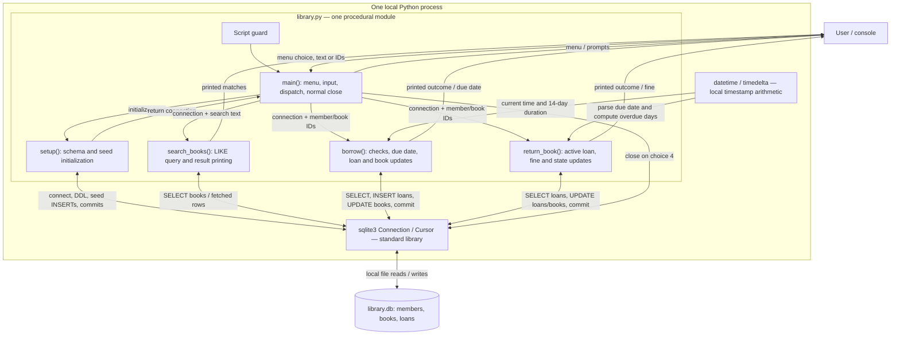

# Current Legacy Architecture
Task: #10 | Owner: Abdulwahab Najib | Status: draft | Date: 16/11

## Report summary

The current LMS is a single-process command-line application implemented in library.py. Its script guard starts main(), which obtains one SQLite connection from setup() and passes it to search_books(), borrow() or return_book() according to the menu selection. The functions are logical responsibilities inside one module, not separately deployed components or independent architectural layers. Search reads book rows; borrowing reads eligibility and availability data, inserts a loan and updates the book; returning reads a loan and updates loan and book state. Every operation issues SQL directly through the SQLite driver and prints its own result to the console. Borrowing and returning use local timestamps from datetime for due dates and fines. The database is the local library.db file, resolved from the current working directory. There is no web server, GUI, service layer or repository abstraction, and main() closes the connection on the normal Exit path.

## Details

### Scope and evidence

- As-is source: `library.py`, revision `abd4b09`, unchanged.
- Traced the full entry, initialization, menu dispatch and exit paths, plus every SQL statement in all five functions.
- Figure 3 deliberately shows code responsibilities inside one module and one process, rather than drawing a proposed layered design as if it already existed.
- Draft awaits Abdulwahab's verification and a separate task PR. Word section 3.4 and the task-table row remain unchanged until merge.

### Figure 3: current (as-is) architecture and data flow

Arrows label calls or exchanged data, not network connections. The operation functions also return values to their caller: search returns rows and borrow/return return booleans. main() does not use those values. Output arrows go directly from the functions to the console because results are printed inside them.

### Components and read/write paths

| Component / responsibility | Data flow | Source location |
|---|---|---|
| Script entry | Calls main() only when executed directly | Lines 213–214 |
| Menu and connection lifetime | Opens via setup(); reads input; converts book IDs; passes connection; closes on Exit | main(), lines 182–212 |
| Initialization | Connects to relative DB path; creates three tables if missing; inserts missing seed rows; returns connection | DB line 4; setup(), lines 5–59 |
| Search | Text → parameterized title/author LIKE query → fetched tuples → console; no write | search_books(), lines 60–75 |
| Borrow | Member/book IDs → members/books lookups → active-loan count → due timestamp → INSERT loan + UPDATE book → commit → console | borrow(), lines 76–142 |
| Return | Member/book IDs → matching active loan → parsed due timestamp + local clock → fine → UPDATE loan + UPDATE book → commit → console | return_book(), lines 143–181 |

### Boundaries of the current architecture

- One Python module combines presentation, lending policy and persistence; the diagram's function boxes are not independent modules or classes.
- All four storage-using functions contain SQL; no shared repository/DAO or configurable storage interface sits between them and sqlite3.
- SQLite is an embedded driver and local file, not a separate database server. No external packages are needed.
- setup() commits after schema creation and again after seeding; borrow() and return_book() each commit after their state updates. The code supplies no explicit exception recovery, rollback handler or finally-based cleanup.
- Local naive wall-clock timestamps are persisted as ISO text. No separate clock service, scheduler or background overdue processor exists.
- There are no copy-management or equipment-system components yet. Those belong to future maintenance/reuse work, not this as-is diagram.

The diagram provides the starting point for Muayyad's task #30 domain architecture. Nasser's task #12 may analyze coupling in greater detail; this task records the current component/data-flow structure without duplicating that dependency analysis.

### Report handoff: section 3.4 (60-word budget)

Figure 3 shows a single-process CLI in library.py. main obtains a SQLite connection from setup and passes it to search, borrow and return functions. These functions combine console output, business rules and direct SQL against library.db. datetime supplies local timestamps for due dates and fines. No service or repository layer separates responsibilities; menu exit closes the shared connection.

After the task PR merges, insert Figure 3 in its existing placeholder and replace only section 3.4's instruction. Keep the caption and figure number.

## Screenshots

None required: Figure 3 is provided as Mermaid, as allowed by PLAN.md. It was derived from source calls and queries, not an imagined future architecture.

## Sources

1. Project primary sources: `library.py`, `README.md`, `PLAN.md`, `docs/00-environment-setup.md`, `docs/01-project-charter.md`, `docs/02-risk-issue-log.md`; task #10 and section 3.4 in `SE431-ProjectReport.docx` (Microsoft Word MCP, 16/11/2026).
2. OpenAI GPT-6.1 Sol, via OpenCode, 16/11/2026: assisted entry-to-exit source tracing, diagramming and drafting. Abdulwahab must verify and rewrite the draft before submission under PLAN.md's authorship rule.
