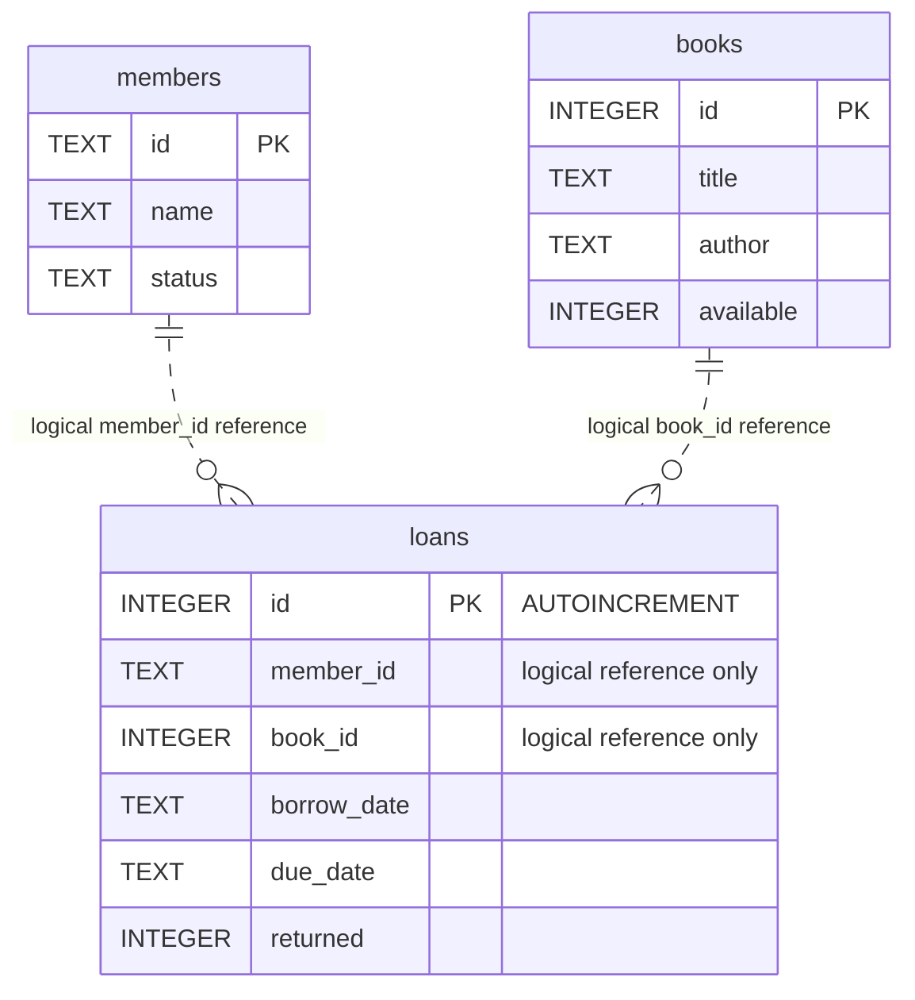

# Legacy Database Schema
Task: #9 | Owner: Abdulwahab Najib | Status: draft | Date: 16/11

## Report summary

The legacy LMS stores data in three SQLite tables: members, books and loans. Each table has an id primary key. Members contain a name and status; books contain a title, author and integer availability flag. Loans record the member and book identifiers, borrowing and due timestamps, and a returned flag. The program treats each loan as belonging to one member and one book, but the schema declares neither relationship as a foreign key. Availability represents one borrowable book record, not a stock quantity or separate physical copies. Borrowing inserts a loan and clears availability; returning marks the loan returned and restores availability. Dates are stored as ISO-formatted text, and fines are calculated during return rather than stored. These findings come from setup(), the borrowing and return SQL, and inspection of both a fresh in-memory database and the existing database opened read-only.

## Details

### Scope and evidence

- As-is source: `library.py` at repository revision `abd4b09`; table definitions at lines 5–34.
- On 16/11, `setup()` was run with `DB = ":memory:"` in the importing process only; no source edit was made.
- Python 3.14.6 / SQLite 3.50.4: `PRAGMA table_info`, `PRAGMA foreign_key_list` and `sqlite_master` confirmed the definitions below.
- The existing `library.db` was opened with SQLite URI `mode=ro`; its three application-table definitions matched the fresh database.
- Draft awaits Abdulwahab's verification and a task-specific PR; the Word report and task-row strike-through are deferred until merge.

### Data dictionary

| Table | Column | Declared type | Key / database constraint | Meaning in the application |
|---|---|---|---|---|
| members | id | TEXT | PRIMARY KEY | Member identifier, e.g. S1 |
| members | name | TEXT | None | Display name; not read by borrow() |
| members | status | TEXT | None | Only the exact string ACTIVE passes borrowing validation |
| books | id | INTEGER | PRIMARY KEY; rowid alias | Book identifier |
| books | title | TEXT | None | Searchable title |
| books | author | TEXT | None | Searchable author |
| books | available | INTEGER | None | Intended flag: 1 available, 0 unavailable |
| loans | id | INTEGER | PRIMARY KEY AUTOINCREMENT; rowid alias | Loan identifier generated on insertion |
| loans | member_id | TEXT | No FOREIGN KEY declaration | Logical reference to members.id |
| loans | book_id | INTEGER | No FOREIGN KEY declaration | Logical reference to books.id |
| loans | borrow_date | TEXT | None | datetime.now().isoformat() at borrowing |
| loans | due_date | TEXT | None | Borrowing timestamp plus 14 days, ISO-formatted |
| loans | returned | INTEGER | None | Application writes 0 for active and 1 for returned |

No column has an explicit `NOT NULL`, `CHECK` or `DEFAULT` clause. SQLite's integer primary keys contain generated or supplied integers, despite the `notnull=0` metadata returned by `table_info`. In this ordinary, non-STRICT schema, `members.id TEXT PRIMARY KEY` can contain NULL; a disposable-database insertion confirmed this SQLite behavior [2]. Non-key fields are nullable. Status and flags have no database-enforced value sets.

### Figure 2: legacy database schema

The cardinalities describe the intended application model, not enforced referential integrity. One member or book can have zero or many historical loans; each valid application-created loan identifies one member and one book. Dashed links denote non-identifying logical relationships; neither field is labelled as an enforced foreign key. The database itself permits NULL and orphaned references.

### Initialization and state changes

| Operation | Tables and changes | Code evidence |
|---|---|---|
| Startup | CREATE TABLE IF NOT EXISTS; commits schema, inserts missing seed rows using INSERT OR IGNORE, then commits | setup(), lines 5–59 |
| Seed members | S1 / Ali / ACTIVE; S2 / Sara / ACTIVE | Lines 38–44 |
| Seed books | 1 / Clean Code / Robert Martin / 1; 2 / Refactoring / Martin Fowler / 1; 3 / Design Patterns / Gamma et al. / 1 | Lines 46–56 |
| Search | Reads books.id, title, author and available | search_books(), lines 60–75 |
| Borrow | Reads members, books and active-loan count; inserts loans row with returned=0; updates books.available=0; commits | borrow(), lines 76–142 |
| Return | Reads matching active loan; updates loans.returned=1 and books.available=1; commits | return_book(), lines 143–181 |

The initial loan table is empty. Re-running startup does not reset an existing matching seed row. `sqlite_sequence` is an SQLite-managed table associated with AUTOINCREMENT, not a fourth application entity. SQLite also supplies the primary-key index for members; the source creates no additional indexes, triggers or views.

The file path is `library.db` relative to the process's current working directory, not necessarily the directory containing `library.py` (line 4). There are no copy, fine, payment or return-timestamp columns/tables. The schema has no uniqueness constraint restricting a book to one active loan; normal sequential application behavior relies on the availability check and update instead. These are observations for the maintenance team, not schema changes proposed by this task.

### Report handoff: section 3.3 (50-word budget)

The legacy SQLite database contains members, books and loans, each with an id primary key. Loans reference members and books logically, without declared foreign keys. Availability and return state use integer flags; dates use ISO text. Figure 2 shows the intended relationships. Copies and fines have no separate stored records.

After this task's PR merges, insert the ER diagram at Figure 2 and replace only section 3.3's placeholder. Keep the existing caption and numbering.

## Screenshots

None required: Figure 2 is supplied as Mermaid above, as permitted by PLAN.md. Database inspection used textual metadata, not a captured screenshot.

## Sources

1. Project primary sources: `library.py`, `README.md`, `PLAN.md`, `docs/00-environment-setup.md`, `docs/01-project-charter.md`, `docs/02-risk-issue-log.md`; task #9 and section 3.3 in the open `SE431-ProjectReport.docx` (read via Microsoft Word MCP, 16/11/2026).
2. SQLite, [CREATE TABLE: PRIMARY KEY and column definitions](https://www.sqlite.org/lang_createtable.html), accessed 16/11/2026. Used to distinguish declared types, NULL behavior and actual constraints.
3. OpenAI GPT-6.1 Sol, via OpenCode, 16/11/2026: assisted code tracing, schema verification and drafting. Abdulwahab must verify and rewrite the draft in his own words before submission, as required by PLAN.md.
