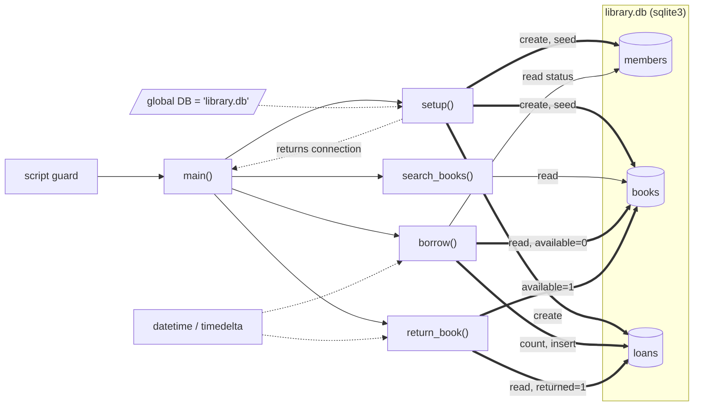
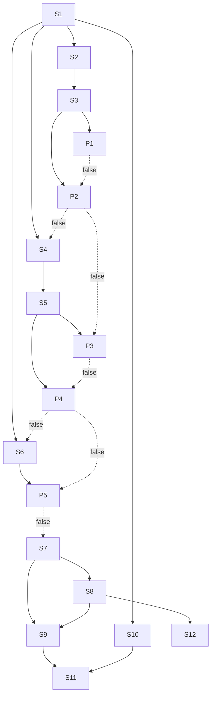

# Dependency Analysis of the Legacy System
Task: #12 | Owner: Nasser Ali Atef | Status: done | Date: 18/11

## Report summary

We looked through the dependencies of library.py to know what a change there would affect, which is called impact analysis, using the course's call graph and program dependency graph. The external dependencies are only the built-in sqlite3 and datetime, nothing more. The call graph is flat: main() calls the four other functions, and all the other functions call nothing. There is a hidden dependency between the functions, as they are all linked through the database: one connection is passed to all of them, and borrow() writes the loans table and books.available, which return_book() and search_books() read later. Inside borrow() there are five checks in a fixed order, so this order is part of the behavior. Changing the database (MR-02) affects all five functions, and changing books.available (MR-01) affects four of them, which serves as the starting point for MR-01 and MR-02.

## Details

### Method

Following the course's impact-analysis chapter, the dependencies were collected at three levels:

1. **Call graph.** Which function calls which (dependency-based impact analysis, course pp. 21, 228).
2. **Data dependencies across functions.** How values move between functions: global variables, input parameters, return values (intermodule change propagation, p. 237). The database tables act as shared state, so they are included too.
3. **Program dependency graph (PDG) of `borrow()`.** Data and control dependencies between the statements of the most complex function (p. 229).

All facts were read from `library.py` at commit `b3ed8d3`, which is unchanged since Commit 01. Function calls were checked with the `ast`-based `tools/metrics.py` from task #14 (branch `nasser/baseline-metrics`).

### External dependencies

| Dependency | Kind | Used by | Purpose |
|---|---|---|---|
| `sqlite3` | standard library | `setup()` (connect); all operations through the connection and cursor | Database access |
| `datetime.datetime` | standard library | `borrow()`, `return_book()` | Current time, ISO text, date parsing |
| `datetime.timedelta` | standard library | `borrow()` | 14-day loan period |
| `library.db` file | runtime environment | `setup()` through the `DB` global | Created in the current working directory, not next to the script |
| Console (`input`, `print`) | runtime environment | `main()`, `search_books()`, `borrow()`, `return_book()` | User interaction and results |

There are no third-party packages.

### Call graph

| Caller | Callees (project functions) | Fan-out |
|---|---|---|
| script guard (line 213) | `main()` | 1 |
| `main()` | `setup()`, `search_books()`, `borrow()`, `return_book()` | 4 |
| `setup()`, `search_books()`, `borrow()`, `return_book()` | none | 0 |

Each operation is called from one place in `main()`, so each has a fan-in of 1. No operation calls another, for example `return_book()` does not reuse any lookup from `borrow()`.

### Data passed between functions (intermodule propagation)

| From → to | What | Type of propagation (course p. 237) |
|---|---|---|
| global `DB` → `setup()` | database file name | global variable |
| `setup()` → `main()` | open `sqlite3.Connection` | output (return value) |
| `main()` → `search_books()` | connection, search text | input parameters |
| `main()` → `borrow()`, `return_book()` | connection, member ID (text), book ID (`int`) | input parameters |
| `search_books()` → `main()` | list of rows (ignored by `main()`) | output |
| `borrow()`, `return_book()` → `main()` | `True` / `False` (ignored by `main()`) | output |
| `borrow()` → `return_book()`, `search_books()`, later `borrow()` calls | loan rows and `books.available` | shared database state (behaves like a global variable) |

`main()` ignores every return value, because each function prints its own result. So the visible behavior depends on what each function prints, not on what it returns.

### Function–table dependency matrix

C = creates the table, I = inserts, R = reads, U = updates.

| Function | `members` | `books` | `loans` |
|---|---|---|---|
| `setup()` | C, I (seed) | C, I (seed) | C |
| `search_books()` | – | R (`title`, `author`, `available`) | – |
| `borrow()` | R (`status`) | R, U (`available` = 0) | R (count active), I |
| `return_book()` | – | U (`available` = 1) | R (active loan, `due_date`), U (`returned` = 1) |
| `main()` | – | – | – (only closes the connection) |

`books.available` is written by three functions (`setup()` seeds it, `borrow()` and `return_book()` change it) and read by two. `loans` is written by two functions and read by two. These are the two places where functions depend on each other with no call between them.

### Figure 4: dependency graph

Plain arrows between functions are calls. Thick arrows write to a table, plain arrows into a table only read it, and dotted arrows are other data dependencies.

### Program dependency graph of `borrow()` (lines 76–142)

| Node | Line | Statement | Data depends on | Control depends on |
|---|---|---|---|---|
| S1 | 77 | `c = db.cursor()` | parameter `db` | – |
| S2 | 78 | select member by `member_id` | S1, `member_id` | – |
| S3 | 83 | `member = c.fetchone()` | S2 | – |
| P1 | 85 | `if not member` → print, return False | S3 | – |
| P2 | 89 | `if member[1] != "ACTIVE"` → print, return False | S3 | P1 false |
| S4 | 93 | select `available` by `book_id` | S1, `book_id` | P2 false |
| S5 | 98 | `book = c.fetchone()` | S4 | P2 false |
| P3 | 100 | `if not book` → print, return False | S5 | P2 false |
| P4 | 104 | `if book[0] == 0` → print, return False | S5 | P3 false |
| S6 | 108 | count active loans of `member_id` | S1, `member_id` | P4 false |
| P5 | 114 | `if count >= 3` → print, return False | S6 | P4 false |
| S7 | 118 | `today = datetime.now()` | – | P5 false |
| S8 | 119 | `due = today + timedelta(days=14)` | S7 | P5 false |
| S9 | 121 | insert loan | S1, S7, S8, `member_id`, `book_id` | P5 false |
| S10 | 133 | set `books.available = 0` | S1, `book_id` | P5 false |
| S11 | 138 | `db.commit()` | S9, S10 | P5 false |
| S12 | 140 | print due date | S8 | P5 false |

Solid edges are data dependencies and dashed edges are control dependencies, as in the course's Figure 6.10 (p. 230). Each check returns early, so every later statement is control-dependent on all earlier checks being false. That makes the order of the checks part of the observable behavior. For example, an inactive member asking for a missing book gets "Member is not active", not "Book not found".

Static slices from this PDG, used later (p. 231):
- **Slice on `books.available` (MR-01):** S1, S4, S5, P4, S10, plus the update in `return_book()` (line 169) and the read in `search_books()` (line 62).
- **Statements that talk to SQLite (MR-02):** S1, S2, S4, S6, S9, S10, S11. Five of them (S2, S4, S6, S9, S10) are SQL statements, out of 17 in the whole program.

### Ripple effect of likely changes

Ripple effect means that changing one variable may force changes in several parts of the program (course p. 212). Here the "variables" include the shared tables.

| If this changes | Functions that must change or be re-checked | Why |
|---|---|---|
| Database engine or file (MR-02) | `setup()`, `search_books()`, `borrow()`, `return_book()`, `main()` | Each function uses `sqlite3` calls and raw SQL directly; `main()` closes the connection |
| Meaning of `books.available`, e.g. copies (MR-01) | `setup()`, `search_books()`, `borrow()`, `return_book()` | The flag is seeded, displayed, checked, cleared and set in four places |
| Columns of `loans` | `setup()`, `borrow()`, `return_book()` | Created in one function, inserted and counted in another, read and updated in a third |
| Member status values | `setup()`, `borrow()` | Seeded as `'ACTIVE'`; compared to the literal `"ACTIVE"` |
| Loan period (14 days) or limit (3 books) | `borrow()` | Hard-coded literals at lines 119 and 114 |
| Fine rule | `return_book()` | Computed inline at lines 161–162 |
| Output wording or language | `search_books()`, `borrow()`, `return_book()`, `main()` | Messages are printed inside the business functions |

For impact analysis on MR-01 and MR-02 (tasks #16 and #19), the rows above are the starting impact sets (SIS, course p. 214).

### Report handoff: section 3.6 (70-word budget)

The call graph was flat, as main() only calls the other functions, but there is hidden coupling through the database, as some functions read and write the same tables. Changing the database will affect all 5 functions, as four of them use SQL statements and main() closes the connection, while changing books.available will affect 4 of them. Figure 4 shows these dependencies.

## Screenshots

None required: Figure 4 and the PDG are Mermaid diagrams in this file, as PLAN.md allows. Export Figure 4 to `docs/img/phase1/dependencies.png` when it is placed in the Word report.

## Sources

1. Tripathy, P. and Naik, K. *Software Evolution and Maintenance: A Practitioner's Approach*, course slides in `docs/reference/maintenance-course.pdf`: impact analysis and dependency analysis, PDF pp. 21–22; ripple effect, p. 212; impact sets (SIS, CIS), p. 214; dependency-based impact analysis, p. 228; program dependency graph, pp. 229–230; static slice, p. 231; intermodule change propagation, p. 237.
2. Project files: `library.py`, `PLAN.md`, `docs/phase1/database-schema.md`, `docs/phase1/class-responsibilities.md`, `tools/metrics.py` (task #14).
3. Claude (Anthropic, Claude Code), 18/11/2026: traced the code and drafted the Details section. Nasser went through each section with it, checked it against `library.py` and wrote the Report summary.
