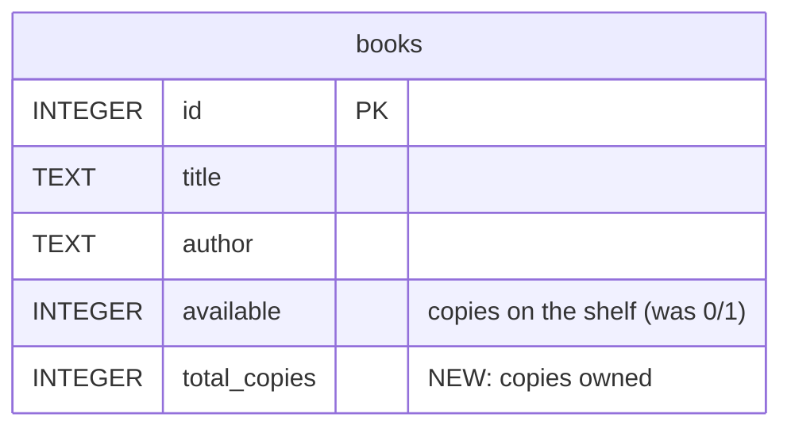

# MR-01: Multiple Copies of Each Book
Task: #16–#18 | Owner: Nasser Ali Atef | Status: draft | Date: 19/11

## Report summary

DRAFT: Nasser to rewrite in his own words. MR-01 says the library bought several copies of each book, so the system must allow more than one available copy. We classify it as perfective maintenance: it improves the system for its users. In the course's activity-based classification, it is an enhancement that changes an existing requirement, because "a book can only be borrowed when available" now means "when a copy is available". Impact analysis started from the dependency results of task #12. Four of the five functions are affected (setup, search_books, borrow and return_book), and one table, books. The members and loans tables do not change. We compared two designs, a copy count in books and a separate copies table. We chose the copy count because it changes the least code and keeps loans as they are. available now holds the copies on the shelf, and a new column, total_copies, holds the copies owned. We implemented the change and checked it with the same scenario as the legacy system. All differences in the output are the intended effect of having copies.

## Details

### Request (from the project description)

> **MR-01:** The library has purchased multiple copies of each book. The system must support more than one available copy.

### 4.1.1 Maintenance classification

| View (course) | Class | Why |
|---|---|---|
| Intention-based (p. 35, p. 38) | **Perfective** | The system works correctly; the change improves what it offers its users. It does not fix a failure (not corrective) and does not react to a new hardware or software environment (not adaptive). |
| Activity-based, Kitchenham et al. (p. 40) | **Enhancement that modifies an existing requirement** | Original requirement 3, "A book can only be borrowed when available", changes meaning: a book is available while at least one copy is on the shelf. |

Some authors would call this adaptive, because the library's stock (its data environment, p. 37) changed. We chose perfective because the request comes from users asking for new capability, and no technical environment changed.

### 4.1.2 Impact analysis

Method: the course's impact-analysis process (pp. 213–214). The **starting impact set (SIS)** is everything that stores or uses book availability. We took it from the function–table matrix and the slice on `books.available` in task #12. The **candidate impact set (CIS)** adds every function that reads or writes those items.

**Table 5: MR-01 impact**

| Component | Affected? | Change needed | Why |
|---|---|---|---|
| `setup()` | Yes | add `total_copies` column; migrate old databases; seed copies | creates and seeds `books` |
| `search_books()` | Yes | show copies available / owned | reads `books.available` |
| `borrow()` | Yes | allow borrowing while copies remain; take one copy | checks and clears `books.available` |
| `return_book()` | Yes | put one copy back, never above the number owned | sets `books.available` |
| `main()` | No | – | never touches availability |
| table `books` | Yes | `available` becomes a count; new column `total_copies` | holds availability |
| table `loans` | No | – | a loan still links one member to one book title |
| table `members` | No | – | not related to copies |

Actual impact set after implementation: the same four functions and one table, so there was no false positive and no newly discovered impact (p. 214).

Ripple to other tasks:
- Muayyad's behavior tests (#23) must expect the new search text and the new borrowing results.
- Abdulwahab's final metrics will include the new migration branch in `setup()`.

### 4.1.3 Proposed design

**Options considered**

| Option | Idea | For | Against |
|---|---|---|---|
| A. Copy count in `books` (chosen) | `available` = copies on the shelf, new `total_copies` = copies owned | Smallest change: 4 functions, 1 table; loans unchanged; old databases migrate with one `ALTER TABLE` | Cannot tell *which* physical copy a member has |
| B. Separate `copies` table | one row per physical copy (`copy_id`, `book_id`, `status`); loans point to `copy_id` | Tracks each copy, e.g. damaged or lost | Changes `loans` and all its queries; more migration work; nothing in the requirements asks for per-copy tracking |

We chose A, because the request only asks for more than one available copy. B is noted as the next step if the library later needs per-copy tracking.

**Schema change**

**Behavior after the change**

| Operation | Legacy | After MR-01 |
|---|---|---|
| Search | `Available: True` | `Available: True (2 of 3 copies)`, and `True` while at least one copy is on the shelf |
| Borrow | refused if `available == 0`; sets `available = 0` | refused if `available <= 0`; `available = available - 1` |
| Return | sets `available = 1` | `available = available + 1`, only while below `total_copies` |
| Existing `library.db` | – | `setup()` adds `total_copies` and sets it to 1, so every book keeps its one copy |
| Seed data (new database) | 1 copy each | Clean Code 3, Refactoring 2, Design Patterns 2 |

All other rules stay as they are: active member, 3-book limit, 14-day period and fine.

### Implementation (bonus)

Commit `1138b5c` on this branch changes only `library.py`: 20 lines added and 9 changed.

| Where | Change |
|---|---|
| `setup()`, lines 16–32 | `total_copies` in `CREATE TABLE`; `PRAGMA table_info` check, then `ALTER TABLE` plus `total_copies = 1` for old databases |
| `setup()`, seed rows | inserts 5 values with copy counts |
| `search_books()`, lines 69–85 | selects `total_copies` and prints `(n of m copies)` |
| `borrow()`, lines 114 and 144 | `available <= 0` check; `available = available - 1` |
| `return_book()`, lines 179–182 | `available = available + 1 WHERE available < total_copies` |

Cyclomatic complexity of `setup()` goes from 1 to 3 because of the migration check. The average goes from 3.8 to 4.2 (radon 6.0.1, same settings as task #14).

### Verification

The same scripted scenario was run on the legacy code and on the new code, each from a fresh database. Lines that differ:

| Step | Legacy | After MR-01 | Expected? |
|---|---|---|---|
| search 'refactor' | `Available: True` | `Available: True (2 of 2 copies)` | yes, shows copies |
| borrow S2, book 1 (S1 already has one) | `Book is unavailable` | `Book borrowed` | yes, a second copy is on the shelf |
| borrow S1, book 1 again | `Book is unavailable` | `Book borrowed` | yes, see open question 1 |
| search 'clean' after 3 loans | `Available: False` | `Available: False (0 of 3 copies)` | yes |
| borrow S1, book 3 (S1 has 3 loans) | `Book borrowed` | `Borrowing limit reached` | yes: the limit is now reachable, because S1 holds 3 copies |
| return S1, book 1 again | `Active loan not found` | `Book returned` | yes, S1 had two copies out |

Unchanged lines:
- member not found, book not found, return without a loan;
- the due date (today + 14 days);
- every return value except those listed above.

Migration test:
1. A database made by the legacy code with one active loan was opened by the new code. The books got `total_copies = 1`.
2. Borrowing the lent book was refused ("Book is unavailable").
3. Returning it worked, and a second return was refused.
4. `available` never went above `total_copies`.

### Open questions for the team

1. **Can one member borrow two copies of the same title?** The requirements do not forbid it, so the new code allows it, and each copy counts toward the 3-book limit. If the team decides against it, `borrow()` needs one more check. Abdulwahab should confirm this under the business rules (#8).
2. **How are new copies added later?** There is no menu option; copies are set in the seed data or directly in the database. Adding one is a separate feature request, out of the charter's scope.

### Report handoff: section 4.1 (170-word budget)

DRAFT: Nasser to rewrite. MR-01 asks the system to support more than one available copy of a book. It is perfective maintenance, and an enhancement that modifies existing requirement 3. Impact analysis (Table 5) found four affected functions (setup, search_books, borrow, return_book) and one affected table, books; members and loans are unchanged. Of two designs, a copy count in books or a separate copies table, we chose the count, as it changes the least code and keeps loans intact. available now counts copies on the shelf and a new total_copies column holds the copies owned. Borrowing takes one copy, returning puts one back, and search shows "2 of 3 copies". Old databases are migrated automatically with one copy per book. A scripted before-and-after run confirmed that only availability results changed, and that the three-book limit can now be reached.

## Screenshots

None yet. The verification table above comes from the scripted run. A screenshot of a search showing "(2 of 3 copies)" can be added as `docs/img/phase2/mr01-search.png`.

## Sources

1. Tripathy, P. and Naik, K. *Software Evolution and Maintenance: A Practitioner's Approach*, course slides in `docs/reference/maintenance-course.pdf`: intention-based classification, PDF pp. 35, 37–38; activity-based classification, p. 40; impact analysis process and impact sets, pp. 213–214; dependency-based impact analysis, p. 228.
2. SE431 Fall 2026 Project Description (Phase 2, MR-01).
3. Project files: `library.py`, `docs/phase1/dependencies.md` (#12), `docs/phase1/database-schema.md` (#9), `docs/phase1/baseline-metrics.md` (#14).
4. SQLite documentation, "ALTER TABLE" and "PRAGMA table_info", https://www.sqlite.org/lang_altertable.html and https://www.sqlite.org/pragma.html#pragma_table_info.
5. Claude (Anthropic, Claude Code), 19/11/2026: implemented the change, ran the before/after scenario and drafted this file. Nasser must go through it and rewrite the summary and report text in his own words before the pull request.
