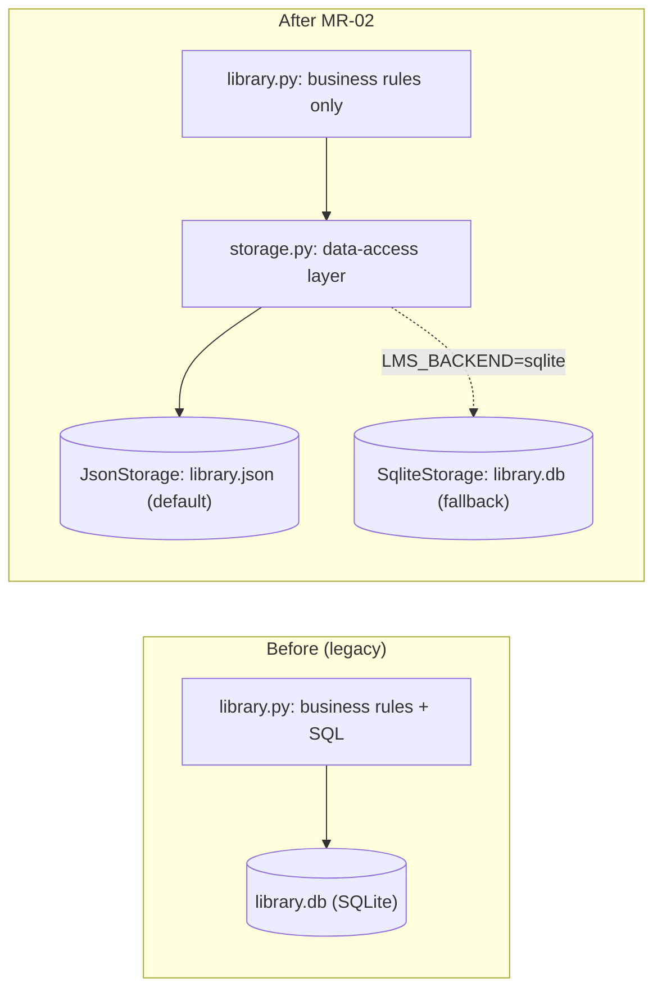

# MR-02: Replacing the Database Implementation
Task: #19–#21 | Owner: Nasser Ali Atef | Status: draft | Date: 19/11

## Report summary

DRAFT: Nasser to rewrite in his own words. MR-02 asks to replace the current database implementation while keeping the business functionality unchanged. We classify it as adaptive maintenance, because the system has to fit a changed data environment. In the course's activity-based classification, it is an enhancement that changes the implementation without changing any requirement. Impact analysis, based on task #12, found that every function depends on SQLite. 17 SQL statements are spread across four functions, plus main(), which closes the connection, and all three tables are affected. The design follows the course's database wrapper and gateway idea. A new data-access layer, storage.py, now holds every database operation behind one set of methods, and library.py calls those methods instead of writing SQL. Two stores implement the layer: a JSON file store, which is the new default, and the old SQLite database, kept as a fallback. An existing library.db is converted automatically on first start. The same scenario gives identical output on the old code and on both stores, so the business behavior did not change.

## Details

### Request (from the project description)

> **MR-02:** The university wants to replace the current database implementation. The business functionality should remain unchanged.

The request does not name a target database. We read it as two needs:
1. the system must be able to change its database without rewriting the business logic;
2. the current SQLite implementation is actually replaced.

### 4.2.1 Maintenance classification

| View (course) | Class | Why |
|---|---|---|
| Intention-based (p. 35, p. 37) | **Adaptive** | The change makes the system fit a changed data environment, a new storage technology. Nothing is broken (not corrective), and users get no new capability (not perfective). |
| Activity-based, Kitchenham et al. (p. 40) | **Enhancement that modifies the implementation without changing the requirements** | The request says "the business functionality should remain unchanged". All six original requirements and MR-01 stay exactly as they are. |

### 4.2.2 Impact analysis

Method: the course's impact-analysis process (pp. 213–214), starting from task #12. The **starting impact set** is every place that uses `sqlite3` or SQL. The dependency analysis already gave the **candidate impact set**: the ripple-effect row "database engine or file" names all five functions.

**Table 6: MR-02 impact**

| Component | Affected? | Legacy dependency on the database | Change |
|---|---|---|---|
| `setup()` | Yes | `sqlite3.connect`, 3 `CREATE TABLE`, seed `INSERT`s, migration (MR-01) | now one call: `storage.open_storage()` |
| `search_books()` | Yes | 1 `SELECT` with `LIKE` | calls `db.search_books(text)` |
| `borrow()` | Yes | 3 `SELECT`s, 1 `INSERT`, 1 `UPDATE`, commit | calls `find_member`, `find_book`, `count_active_loans`, `add_loan` |
| `return_book()` | Yes | 1 `SELECT`, 2 `UPDATE`s, commit | calls `find_active_loan`, `close_loan` |
| `main()` | Yes, but no code change | closes the connection | `db.close()` now closes whichever store is open |
| global `DB` | Yes | file name `library.db` | moved into `storage.py` |
| table `members` | Yes | stored in SQLite | stored by the chosen backend |
| table `books` | Yes | stored in SQLite | stored by the chosen backend |
| table `loans` | Yes | stored in SQLite | stored by the chosen backend |

All 17 SQL statements and every table are affected, but **no business rule changes**. The actual impact set matched the candidate set. One discovered impact (p. 214): SQLite's `LIKE` treats `%` and `_` as wildcards and ignores letter case, so the new store had to copy those exact rules to keep search results unchanged.

### 4.2.3 Proposed design

**Approach.** The course describes **database wrappers** (pp. 185–186) and the **gateway** of the database-first and database-last migration methods (pp. 203–205). In both, a module sits between the programs and the data, so either side can change without touching the other. We apply the same idea inside this small program as a **data-access layer**:



**The layer's interface.** These are the only operations the business logic needs, so every store must provide them:

| Method | Used by | Returns |
|---|---|---|
| `search_books(text)` | `search_books()` | rows `(id, title, author, available, total_copies)` |
| `find_member(member_id)` | `borrow()` | `(id, status)` or `None` |
| `find_book(book_id)` | `borrow()` | `(available,)` or `None` |
| `count_active_loans(member_id)` | `borrow()` | number |
| `find_active_loan(member_id, book_id)` | `return_book()` | `(loan_id, due_date)` or `None` |
| `add_loan(member, book, borrow_date, due_date)` | `borrow()` | saves the loan and takes one copy |
| `close_loan(loan_id, book_id)` | `return_book()` | marks it returned and puts one copy back |
| `close()` | `main()` | – |

The methods return tuples in the same column order as the legacy SQL. So the business functions kept every check, message and check order (PDG in task #12), and only the lines that ran SQL changed.

**Choice of the new store**

| Option | For | Against |
|---|---|---|
| Server database (MySQL, PostgreSQL) | Common in production | Needs a server and a driver package. The team and the marker could not run the demo with Python alone. |
| ORM library (e.g. SQLAlchemy) over SQLite | Hides SQL | Still the same SQLite file, plus an extra dependency |
| **JSON file store (chosen)** | Standard library only. Readable file. Clearly a different implementation. | Rewrites the whole file on every change, so only fine for small data |

The layer is the real deliverable. A server database would be one more class with the same eight methods, and `library.py` would not change again.

**Migration strategy** (course p. 198: schema, data and program conversion):

| Step | What we did |
|---|---|
| Program conversion | Moved all SQL from `library.py` into `SqliteStorage`, and pointed `library.py` at the layer |
| Schema conversion | The three tables became three lists in `library.json`, with the same field names |
| Data conversion | When `library.json` does not exist but `library.db` does, `JsonStorage` reads every row through `SqliteStorage` and writes it to the new file once. Loan IDs continue after the highest old ID. |
| Cut-over (p. 189) | **Cut-and-run** to JSON by default. SQLite stays selectable with `LMS_BACKEND=sqlite`, which allows going back if a problem appears. |

### Implementation (bonus)

Commit `878eb31` on this branch, built on MR-01:

| File | Change |
|---|---|
| `storage.py` (new) | `open_storage()`; `SqliteStorage` (all former SQL, including the MR-01 migration); `JsonStorage` (new store, data conversion, atomic save via a temporary file); `_like()` copies SQLite `LIKE` rules |
| `library.py` | `import sqlite3` and the `DB` global removed; `setup()` is one line; the 3 operations call the layer. Checks, messages and their order are unchanged. |
| `.gitignore` | ignores `library.json` |

How to run each store:

```bash
python library.py
```

```bash
LMS_BACKEND=sqlite python library.py
```

In Windows PowerShell, set the variable first with `$env:LMS_BACKEND = "sqlite"`.

**Effect on the metrics** (radon 6.0.1 and `tools/metrics.py`, same settings as task #14):

| Metric | Legacy | After MR-02 |
|---|---|---|
| SQL statements in `library.py` | 17 | **0** |
| Functions in `library.py` that access the database directly | 4 of 5 | **0 of 5** |
| Global variables in `library.py` | 1 | 0 |
| Files | 1 | 2 (`library.py`, `storage.py`) |
| SLOC, both files | 170 | 269 |
| Average cyclomatic complexity, both files | 3.8 | 2.6 |

The code is longer because there are now two stores, but the business logic no longer depends on any database. These are intermediate numbers. The official comparison is Abdulwahab's task #34 on the final system.

### Verification

| Check | Result |
|---|---|
| Same 15-step scenario as MR-01 (search, borrow, all rejections, limit, return) on MR-01 code vs MR-02 + SQLite | identical output and return values |
| Same scenario on MR-01 code vs MR-02 + JSON | identical output and return values |
| Search edge cases on both stores: `CLEAN`, `gamma`, `%`, `_`, `R_f`, `o%n`, `.`, `\`, `xyz` | identical results |
| Late return (due date 5 days ago) on both stores | `Fine: 5` on both |
| A legacy `library.db` with an active loan, opened by MR-02 (default JSON) | data converted; book shown as unavailable; returning it charged the fine; the next loan got ID 2 |
| Full menu session with `python library.py` (search, borrow, return, invalid choice, exit) | same messages as before; `library.json` created in the working folder |

Muayyad's behavior tests (#23) are not on GitHub yet. When they arrive, they must be run on both stores. This is the check PLAN.md asks for in task #21.

### Notes for the team

- **Phase 3 (Muayyad):** "direct DB access" is now fixed by MR-02, so pick refactorings from the other smells: the long `borrow()`, mixed printing and rules, magic numbers, and tuple indexes (task #13).
- **Final metrics (Abdulwahab, #34):** pass both `library.py` and `storage.py` to radon and `tools/metrics.py`.
- **Open question:** if the instructor expects a specific DBMS, add one more class to `storage.py` with the same eight methods. Nothing else changes.

### Report handoff: section 4.2 (170-word budget)

DRAFT: Nasser to rewrite. MR-02 replaces the database implementation without changing business functionality. It is adaptive maintenance, and an enhancement that changes the implementation but not the requirements. Impact analysis (Table 6) found that all five functions and all three tables depended on SQLite through 17 SQL statements. Following the course's database wrapper and gateway idea, we added a data-access layer, storage.py, that holds every database operation behind eight methods. library.py now calls these methods and contains no SQL. Two stores implement the layer: a JSON file store as the new default, and the old SQLite database as a fallback. An existing library.db is converted automatically on first start. Running the same scenario on the old code and on both stores gave identical output, including search wildcards and late fines, which shows the business behavior is unchanged.

## Screenshots

None yet. The verification table comes from scripted runs. A screenshot of `library.json` after a borrow can be added as `docs/img/phase2/mr02-json-store.png`.

## Sources

1. Tripathy, P. and Naik, K. *Software Evolution and Maintenance: A Practitioner's Approach*, course slides in `docs/reference/maintenance-course.pdf`: intention-based classification, PDF pp. 35, 37; activity-based classification, p. 40; database wrappers, pp. 185–186; cut-over strategies, p. 189; migration strategy (schema, data, program conversion), p. 198; database-first and database-last gateways, pp. 203–205; impact analysis process, pp. 213–214.
2. SE431 Fall 2026 Project Description (Phase 2, MR-02).
3. Project files: `docs/phase1/dependencies.md` (#12), `docs/phase1/code-smells.md` (#13), `docs/phase1/baseline-metrics.md` (#14), `docs/phase2/mr01-multiple-copies.md`.
4. Python documentation: `json` and `os.replace`, https://docs.python.org/3/library/json.html and https://docs.python.org/3/library/os.html#os.replace. SQLite documentation, "The LIKE operator", https://www.sqlite.org/lang_expr.html#like.
5. Claude (Anthropic, Claude Code), 19/11/2026: implemented the layer and both stores, ran the comparisons and drafted this file. Nasser must go through it and rewrite the summary and report text in his own words before the pull request.
