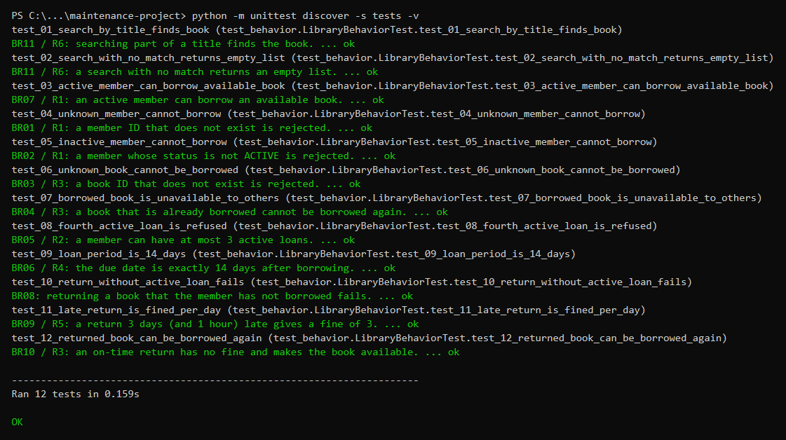

# Behavior-Preservation Tests
Task: #23 | Owner: Karam M. Ali | Status: done | Date: 21/11

## Report summary

Before changing any code, we wrote automated tests that record how the legacy system behaves today. There are 12 tests in `tests/test_behavior.py`, written with Python's built-in `unittest` module. They cover the three operations a user can perform: search, borrow and return. Every test is linked to one of the six original requirements (R1–R6) and to a business rule found in Phase 1 (BR01–BR11). The tests check what a user can observe: the True/False result, the printed message, and the stored due date. Each test runs on a fresh, temporary database, so the tests do not depend on each other or on the real `library.db`. All 12 tests pass on the legacy code. The same tests act as our regression tests: we run them again after MR-01, MR-02 and every refactoring to show that the system's externally observable behavior has not changed. The only exception is test 07, which MR-01 changes on purpose.

## Details

### Why these tests (course method)

- The IEEE 1219 maintenance process says to create a test suite and select regression test cases during design, then run regression tests during implementation (course PDF pp.88–89). Every type of maintenance ends with regression tests (p.286).
- Refactoring must keep the program's input/output behavior the same as before (p.274). This is the second activity of the refactoring process (p.271). We can only prove that if we record the behavior first, so these tests were written on the unchanged legacy code (Commit 01).

### What is tested

The test data is what `setup()` creates: members S1 (Ali) and S2 (Sara), both ACTIVE, and books 1 to 3. Member `S9` and book `99` are IDs that do not exist, used on purpose to test the "not found" cases.

| Test | Requirement / rule | Input | Expected |
|---|---|---|---|
| 01 | R6 / BR11 | Search "Clean" | One row: book 1, *Clean Code* |
| 02 | R6 / BR11 | Search "zzz" | Empty list, nothing printed |
| 03 | R1 / BR07 | S2 borrows book 1 | True, "Book borrowed. Due: …" |
| 04 | R1 / BR01 | S9 (not a member) borrows book 1 | False, "Member not found" |
| 05 | R1 / BR02 | S2 set to INACTIVE, borrows book 1 | False, "Member is not active" |
| 06 | R3 / BR03 | S1 borrows book 99 (does not exist) | False, "Book not found" |
| 07 | R3 / BR04 | S1 borrows book 1, then S2 borrows book 1 | False, "Book is unavailable" |
| 08 | R2 / BR05 | S1 borrows books 1, 2, 3, then a 4th book | False, "Borrowing limit reached" |
| 09 | R4 / BR06 | S1 borrows book 1 | Due date − borrow date = 14 days |
| 10 | BR08 | S1 returns book 1 without borrowing it | False, "Active loan not found" |
| 11 | R5 / BR09 | S1 returns book 1 three days (and one hour) late | True, "Book returned", "Fine: 3" |
| 12 | R3 / BR10 | S1 borrows and returns book 1 on time, then S2 borrows it | No fine; S2's borrow returns True |

### How the tests work

- Each test runs inside a new temporary folder, so `setup()` creates a fresh `library.db` and the real database is never touched.
- A small helper (`call`) runs a library function and captures what it prints, so both the return value and the message can be checked.
- A second helper (`run_sql`) prepares data that the menu cannot create, for example an inactive member, a 4th book, or a due date in the past.

### How to run

From the repository root:

```
python -m unittest discover -s tests -v
```

### Results

| Version of the code | Result |
|---|---|
| Legacy system (Commit 01, `library.py` unchanged) | 12 / 12 pass |

The same command will be run again for MR-02 (task #21) and after the refactorings (task #27), and the results added to this table.

### Note on MR-01

MR-01 lets the library own more than one copy of a book. This deliberately changes requirement R3, so test 07 (a second member cannot borrow the same book) is expected to fail after MR-01. That test has to be updated to match the new requirement. Updating it is part of keeping regression tests in step with an approved change, and does not mean behavior was broken by mistake. All other tests should still pass.

## Screenshots



*Behavior tests passing on the legacy system (12 tests, OK).*

## Sources

- Course PDF `docs/reference/maintenance-course.pdf` (Tripathy & Naik slides): pp.88–89 (IEEE 1219 regression testing), p.271 (refactoring activities), p.274 (behavior preservation), p.286 (regression tests in maintenance activities).
- Python documentation: `unittest` (unit testing framework) and `contextlib.redirect_stdout`.
- `docs/phase1/requirements.md` (#7) and `docs/phase1/business-rules.md` (#8), for the requirement and rule IDs.
- AI tool: Claude (Anthropic), used to help draft the tests and this document. Reviewed and edited by the author.
