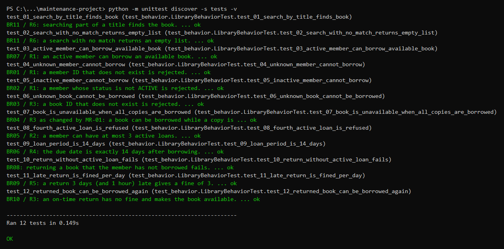

# Refactoring Log
Task: #24, #25, #26, #27 | Owner: Karam M. Ali | Status: done | Date: 21/11

## Report summary

We refactored the borrowing module three times, starting from Commit 03 (the system with MR-01 and MR-02). We followed the refactoring activities from the course: identify what to refactor, make sure behavior is preserved, apply the change, and evaluate its impact. First, the long `borrow()` method was split into four small functions: member validation, availability check, borrow-limit check and loan creation. `borrow()` now only calls them in order. Second, the return and fine logic, which was mixed into `return_book()`, was moved into its own class, `ReturnService`, in `return_service.py`. Third, the magic numbers 3, 14 and the fine rate, and the status text "ACTIVE", became named constants, and row positions such as `member[1]` became named variables. Each refactoring is its own commit. After each one we ran the 12 behavior tests from task #23, and all of them passed. We also ran the menu program with the same input before and after, on both the SQLite and the JSON store, and the output was the same. So the externally observable behavior did not change. `borrow()` went from 33 lines and complexity 6 to 14 lines and complexity 4. The code as a whole grew, because it now has more, smaller functions.

## Details

### Method (course)

The course gives these activities for a refactoring process (course PDF p.271). We used them as the steps for each refactoring:

1. **Identify what to refactor.** Use code smells (p.272). We took the smells from task #13 (`docs/phase1/code-smells.md`).
2. **Ensure behavior is preserved.** The input/output behavior after refactoring must be the same as before (p.274). We check this with the #23 tests and a menu run.
3. **Apply the refactoring.** The refactoring names (Extract Method, Extract Class, Replace Magic Literal) come from Fowler's *Refactoring*, which the course cites for code smells (p.272).
4. **Evaluate the impact.** Measure before and after and compare (p.276), using size and complexity, which are internal qualities (p.275).
5. **Maintain consistency.** Update the documents that describe the code (p.271).

**Starting point.** Commit 03, `498a276`. After MR-02, all SQL is already in `storage.py`, so these refactorings only change `library.py` and add `return_service.py`. `storage.py` was not changed.

**Checking after every commit.**
- The tests run after each refactoring, with `python -m unittest discover -s tests -v`.
- The menu program also runs with the same scripted input on Commit 03 and on the final commit. The script covers search, borrow, return, the "not found" errors, the borrowing limit and an invalid choice. The output is compared line by line, with the due date masked because it depends on today's date.

**How the impact is measured.**
- radon 6.0.1 (`raw` and `cc`), the same version as the baseline in task #14.
- `tools/metrics.py`.
- The lines of each function, counted from the start of its `def` line to its end.

### Table 7: Refactoring summary

| # | Refactoring | Smell Addressed | Before | After |
|---|---|---|---|---|
| 1 | Decompose `borrow()` (Extract Method), task #24 | Long Method (CS1) | `borrow()`: 33 lines, cyclomatic complexity 6, five jobs in one function | `borrow()`: 14 lines, complexity 4, calls `validate_member`, `check_availability`, `check_borrow_limit`, `create_loan` |
| 2 | Separate mixed responsibilities (Extract Class), task #25 | Mixed Responsibilities (AP1) | `return_book()`: 22 lines doing the loan lookup, the fine calculation, the update and the messages | `return_book()`: 3 lines; `ReturnService` has `calculate_fine()` (no database, no printing) and `return_book()` |
| 3 | Replace primitive data / magic numbers (Replace Magic Literal), task #26 | Primitive Obsession: magic numbers (CS6), positional row access / poor naming (CS7) | 3 literals (3, 14, "ACTIVE") plus 1 implicit rule (a fine rate of 1 that was not written anywhere); 9 different row positions (10 uses) such as `member[1]`, `loan[0]`, `row[3]` | 0 literal or implicit rules: `MAX_BOOKS`, `LOAN_DAYS`, `FINE_PER_DAY`, `ACTIVE`; 0 row positions: tuples are unpacked into named variables |

The smell IDs (CS1, CS6, CS7, AP1) are the ones in `docs/phase1/code-smells.md`.

### Refactoring 1: decompose `borrow()` (#24)

**Identify.**
- After MR-02, `borrow()` still did five jobs in one function: check the member, check the book, check the borrowing limit, create the loan, and print the result.
- That is the Long Method smell (p.272, CS1 in task #13). The project description names this method directly.
- It also reduces CS3 (the repeated "look up, check, print, return False" pattern). Each copy of the pattern now sits in its own named function, but the pattern itself is still repeated.

**Behavior preserved.**
- The checks run in the same order, with the same messages, and each failed check returns `False` the same way.
- 12/12 tests pass after commit `b77a9c9`.

**Apply.** Extract Method. Each check becomes a function named after its job in task #24.

Before (Commit 03, abridged):

```python
def borrow(db, member_id, book_id):
    member = db.find_member(member_id)
    if not member:
        print("Member not found")
        return False
    if member[1] != "ACTIVE":
        print("Member is not active")
        return False
    book = db.find_book(book_id)
    ...                      # book not found, unavailable, limit of 3
    today = datetime.now()
    due = today + timedelta(days=14)
    db.add_loan(member_id, book_id, today.isoformat(), due.isoformat())
    print("Book borrowed. Due:", due.date())
    return True
```

After:

```python
def borrow(db, member_id, book_id):
    """Borrow a book: run the three checks in order, then create the loan."""
    if not validate_member(db, member_id):
        return False

    if not check_availability(db, book_id):
        return False

    if not check_borrow_limit(db, member_id):
        return False

    create_loan(db, member_id, book_id)

    return True
```

**Impact.**
- `borrow()` went from 33 to 14 lines, and its cyclomatic complexity from 6 (rank B) to 4 (rank A).
- No new function has a complexity above 3.
- Each rule can now be read, and changed, in one small function.

### Refactoring 2: separate mixed responsibilities (#25)

**Identify.**
- `return_book()` mixed four responsibilities in 22 lines: finding the active loan, calculating the fine, closing the loan, and printing messages.
- This is the "mixed responsibilities" smell from the project description, and AP1 (no separation of concerns) in task #13.

**Behavior preserved.**
- `library.return_book(db, member_id, book_id)` keeps the same name, parameters, return values and messages.
- The menu and the tests call it exactly as before. 12/12 tests pass after commit `04c8474`, including the late-return fine (test 11).

**Apply.** Extract Class. The new file `return_service.py` holds the class `ReturnService`:
- `calculate_fine(due_date, return_date)` only does arithmetic. It does not touch the database or print anything.
- `return_book(member_id, book_id)` runs the return.

Before (Commit 03):

```python
def return_book(db, member_id, book_id):
    loan = db.find_active_loan(member_id, book_id)
    if not loan:
        print("Active loan not found")
        return False
    loan_id = loan[0]
    due = datetime.fromisoformat(loan[1])
    today = datetime.now()
    late = (today - due).days
    fine = late if late > 0 else 0
    db.close_loan(loan_id, book_id)
    print("Book returned")
    if fine:
        print("Fine:", fine)
    return True
```

After (in `library.py`, with the final version of the class in `return_service.py`):

```python
def return_book(db, member_id, book_id):
    """Return a book. The return and fine logic is in ReturnService."""
    return ReturnService(db, FINE_PER_DAY).return_book(member_id, book_id)
```

**Impact.**
- `return_book()` went from 22 lines and complexity 4 to 3 lines and complexity 1.
- The fine rule is now one method with complexity 2. It can be checked without a database, because it only takes two dates.
- The code has 1 class, where before it had none.
- AP1 is only partly solved. The fine calculation is fully separated, but `ReturnService.return_book()` still looks up the loan, updates the store and prints the messages. The printing stays there on purpose, so the output does not change.

### Refactoring 3: replace primitive data and magic numbers (#26)

**Identify.** This is CS6 (magic literals) and CS7 (poor naming) in task #13.
- **Magic literals:** the rules were written as bare values inside the logic: `3` (limit), `14` (days) and `"ACTIVE"`. The fine rate of 1 per day was not written anywhere; it was hidden in `fine = late`.
- **Primitive data:** results were read by position, for example `member[1]`, `book[0]`, `loan[0]`, `loan[1]` and `row[0]` to `row[4]`.

**Behavior preserved.**
- The constants have the same values, and the fine is `days_late * 1`, which equals `days_late`.
- 12/12 tests pass after commit `fca226e`.

**Apply.**
- Replace Magic Literal: the constants are at the top of `library.py`. `ReturnService` receives the fine rate when it is created, so it does not need to import `library.py`.
- Rows are unpacked into named variables, for example `_, status = member` and `loan_id, due_date = loan`.

Before (Commit 03):

```python
if member[1] != "ACTIVE":
...
if db.count_active_loans(member_id) >= 3:
...
due = today + timedelta(days=14)
...
fine = late if late > 0 else 0
```

After:

```python
MAX_BOOKS = 3         # active loans allowed per member
LOAN_DAYS = 14        # normal borrowing period
FINE_PER_DAY = 1      # fine for each full day late
ACTIVE = "ACTIVE"     # member status that may borrow
...
_, status = member
if status != ACTIVE:
...
if db.count_active_loans(member_id) >= MAX_BOOKS:
...
due = today + timedelta(days=LOAN_DAYS)
...
return days_late * self.fine_per_day if days_late > 0 else 0
```

**Impact.**
- Literal rules went from 4 to 0, and row positions from 9 to 0. The remaining numbers in `library.py` are the menu choices "1" to "4".
- To change a rule, you now change one line. These four constants are the values that would move into `LibraryRules` in the reusable architecture from Phase 4 (task #30).

### Overall impact (p.276)

Measured on the files with business logic: `library.py` on Commit 03, and `library.py` + `return_service.py` after. `storage.py` did not change.

| Metric | Commit 03 | After #24–#26 |
|---|---|---|
| `borrow()` lines / cyclomatic complexity | 33 / 6 (B) | 14 / 4 (A) |
| `return_book()` lines / cyclomatic complexity | 22 / 4 (A) | 3 / 1 (A) |
| Highest complexity outside `main()` | 6 | 4 |
| Functions / classes (`tools/metrics.py`) | 5 / 0 | 12 / 1 |
| Physical lines (radon `raw`) | 104 | 156 (119 + 37) |
| Literal or implicit rule values in the logic | 3 + 1 implicit | 0 |
| Global variables (`tools/metrics.py`) | 0 | 4 (the new constants) |
| Functions with console output besides `main()` | 3 | 6 |

The course says that lower coupling, higher cohesion and smaller size usually make a system more maintainable (p.276). Here, complexity per function went down, and each function now has one job, which should improve cohesion (we did not measure cohesion). But total size went up, because of the new functions, the docstrings and the new file. We accept that trade-off: each part is now small and has one purpose. Two other counts also went up. The 4 global variables are the new constants, which are read-only values, not shared state. The functions with console output went from 3 to 6, because each check still prints its own message. We kept the printing inside the functions on purpose, so the output stays exactly the same. Task #34 measures the whole final system against the baseline from task #14.

### Maintain consistency (p.271)

Updated together with the code:
- the Results table in `behavior-tests.md`;
- this log.

In the Phase 4 reuse design (task #30), these values are expected to move into a `LibraryRules` class.

### Smells not handled here

These smells stay open for the final clean-up (#32):
- **CS4:** duplicated input code in `main()`.
- **AP5:** the menu crashes when a book ID is not a number. Fixing AP5 changes what the user sees (an error message instead of a crash), so it is a corrective change, not a refactoring, and does not belong in a step that must preserve behavior.

CS2 (long `setup()`) was already removed by MR-02, which moved the schema and seed data into `storage.py`.

## Verification (#27)

| Version | Behavior tests | Menu run with the same input |
|---|---|---|
| Commit 03 (`498a276`), before refactoring | 12 / 12 pass | reference output |
| After #24 (`b77a9c9`) | 12 / 12 pass | – |
| After #25 (`04c8474`) | 12 / 12 pass | – |
| After #26 (`fca226e`), final | 12 / 12 pass | Same as Commit 03, on the SQLite store and on the JSON store |

The tests use the SQLite store, because five of them prepare data with SQL. The menu run is what checks the JSON store, which is the default after MR-02.

How to repeat the checks:

```
python -m unittest discover -s tests -v
```

For the menu run, the input script `tests/menu_session.txt` (a search, six borrow attempts, two returns, an invalid choice, a search with no match, exit) is piped into `python library.py` on each version, with `LMS_BACKEND=sqlite` and `LMS_BACKEND=json`, in a folder with no existing data file, for example on Git Bash:

```
LMS_BACKEND=json python library.py < tests/menu_session.txt
```

## Screenshots



*Behavior tests after refactorings #24–#26, run on commit `fca226e` (12 tests, OK).*

## Sources

- Course PDF `docs/reference/maintenance-course.pdf` (Tripathy & Naik slides): p.271 (activities in a refactoring process), p.272 (code smells, Fowler), p.274 (behavior preservation), p.275 (internal and external qualities), p.276 (evaluating the impact with before and after metrics).
- M. Fowler, *Refactoring: Improving the Design of Existing Code*, 2nd ed., Addison-Wesley, 2018: Extract Function (Extract Method), Extract Class, Replace Magic Literal.
- `docs/phase1/code-smells.md` (#13) for the smell IDs, and `docs/phase1/baseline-metrics.md` (#14) for the radon version and commands.
- radon 6.0.1 documentation (`raw`, `cc`).
- AI tool: Claude (Anthropic), used to help apply the refactorings, run the checks and draft this document. Reviewed and edited by the author.
