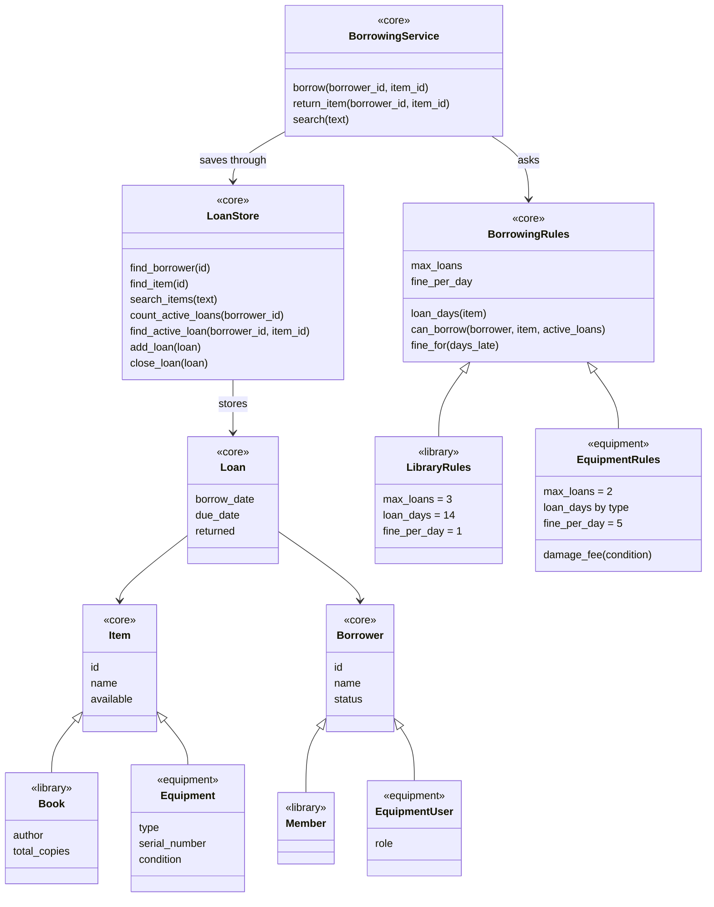
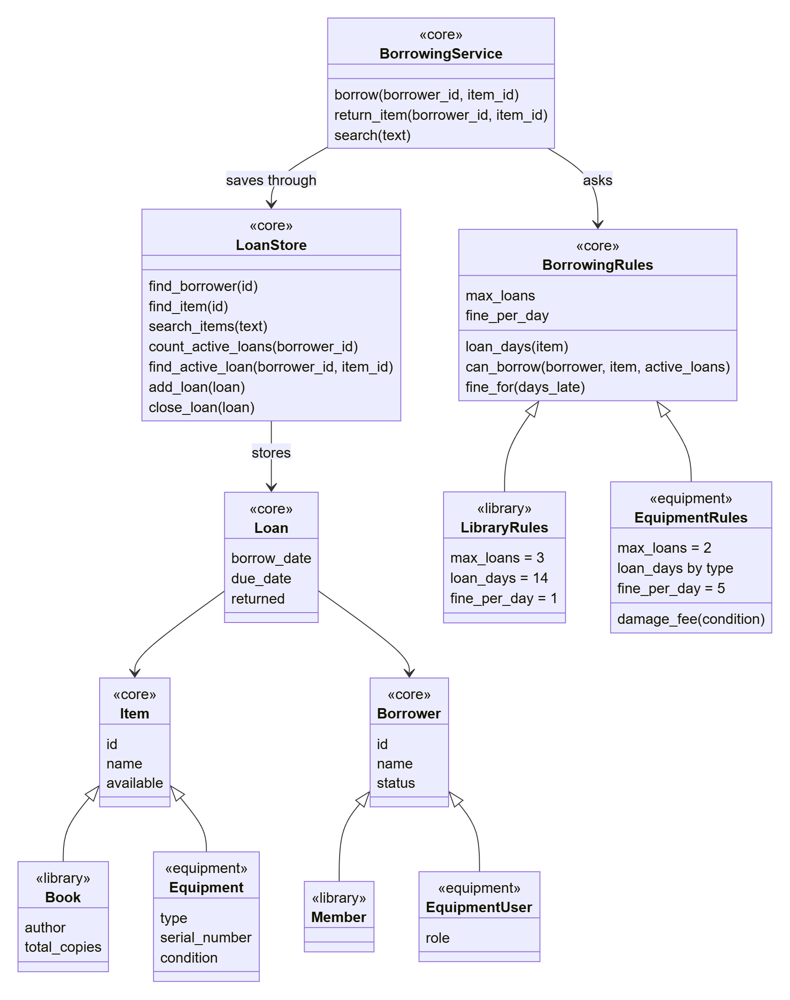

# Reusable Domain Architecture
Task: #30 | Owner: Karam M. Ali | Status: done | Date: 21/11

## Report summary

Using the common and variable features from task #29, we designed one architecture that both the library system and the equipment system can be built from. In the course, this is domain design: developing a generic architecture for the whole family of products (p.363). The architecture has a shared core that holds the common features: a generic `Item`, `Borrower` and `Loan`, a `BorrowingService` that runs borrow, return and search, a `BorrowingRules` class that makes every rule decision, and a `LoanStore` for saving data. Each system then extends the core with the variable features, its own item and borrower types and its own rules, so the library sets 3 books, 14 days and a fine of 1 per day, while the equipment system sets 2 items, a loan period per type and a damage fee. The borrowing process is written once and shared by both systems. We follow the extractive reuse model (p.357), because the core is taken from the library system we already maintain: its borrow and return checks become `BorrowingRules`, and its MR-02 storage layer becomes `LoanStore`.

## Details

### Method

Domain design has two steps in the course (p.363):
1. **Develop a generic architecture for the family:** Figure 5.
2. **Plan how individual systems are built from the reusable parts:** the table "How each system is built" below.

The architecture is an example of architectural reuse: a set of generic elements that can be reused in new systems (p.351).

### Figure 5: Reusable domain architecture

*Figure 5: Reusable domain architecture. The «core» classes are shared by both systems. The «library» and «equipment» classes are the extensions for each system.*

### How the architecture covers the features

| Part of the architecture | Holds | Features from Table 8 |
|---|---|---|
| `BorrowingService` (core) | The borrow, return and search steps, in a fixed order | Borrow item, return item, search |
| `BorrowingRules` (core) | Every rule decision: may this borrower take this item, when is it due, what is the fine | Borrower active, item available, borrowing limit, due date, late fine |
| `Item`, `Borrower`, `Loan` (core) | The data every borrowing system needs | Loan record |
| `LoanStore` (core) | Saving and reading data, hidden behind a few methods: find, search, count active loans, add and close loans | Loan record |
| `Book`, `Equipment` (extensions) | The item details of each system. `Item.name` holds a book's title or an equipment item's name | Item details, search fields |
| `Item.available` with `Book.total_copies` or one `Equipment` unit | How many units are on the shelf: for a book, a count of copies up to `total_copies` (MR-01); for equipment, 0 or 1, because each serial number is one unit | Units per item |
| `EquipmentUser.role` (extension) | Whether the user is a student or staff member (EQ1) | Borrower must exist and be active |
| `LibraryRules`, `EquipmentRules` (extensions) | The values each system chooses, plus the damage fee in the equipment system | Borrowing limit, borrowing period, fine amount, condition check |

### How each system is built (the second design step)

| System | Reuses from the core | Adds |
|---|---|---|
| Library Management System | All core classes | `Book`, `Member`, `LibraryRules` |
| Equipment Borrowing System | All core classes | `Equipment`, `EquipmentUser`, `EquipmentRules` (with the damage fee) |

Building the equipment system this way is what the course calls application engineering: creating a specific system by reusing the assets from domain engineering and adding only the new components it needs (p.366).

### Why this design is reusable

- **Extractive reuse (p.357):** we do not design the core from nothing. It comes from the existing library system.
  - The borrow checks become `BorrowingRules`. In the refactoring phase, task #26 will replace the numbers 3, 14 and the fine rate with named constants, and those constants are the values that move into `LibraryRules`.
  - The data-access layer `storage.py` from MR-02 becomes `LoanStore`. It already has the same kind of methods (`find_member`, `find_book`, `search_books`, `count_active_loans`, `find_active_loan`, `add_loan`, `close_loan`), named for books and members.
  - The copy count from MR-01 becomes `Item.available`.
- **Reusability properties (p.352):**
  - *Low coupling:* the service only talks to the rules and the store through a few methods.
  - *High cohesion:* each class has one job.
  - *Adaptability:* a new system changes the rules and item types, not the borrowing process.
- **Adding a third system:** a room or sports-equipment booking system, for example, would only need new extension classes. The core would not change.

### Report handoff: section 6.3 (70-word budget)

Figure 5 shows a generic architecture for both systems. A shared core holds the common features: `Item`, `Borrower`, `Loan`, `BorrowingService`, `BorrowingRules` and `LoanStore`. Each system extends it with its own item and borrower types and its own rules (limit, loan period, fine rate, and a damage fee for equipment). This follows the extractive reuse model: the core is taken from the library system we maintain.

## Screenshots

*Figure 5: Reusable domain architecture, rendered from the Mermaid diagram above.*

## Sources

- Course PDF `docs/reference/maintenance-course.pdf` (Tripathy & Naik, Chapter 9): p.351 (architectural reuse), p.352 (reusability properties), p.357 (extractive reuse model), p.363 (domain design), p.366 (application engineering).
- `docs/phase4/commonality-variability.md` (#29), for the common and variable features.
- `docs/phase2/mr01-multiple-copies.md` (MR-01), for the copy count reused as `Item.available`.
- `docs/phase2/mr02-database-replacement.md` (MR-02), for the storage layer reused as `LoanStore`.
- Mermaid documentation, class diagrams: https://mermaid.js.org/syntax/classDiagram.html
- AI tool: Claude (Anthropic), used to help draft this document and the diagram. Reviewed and edited by the author.
