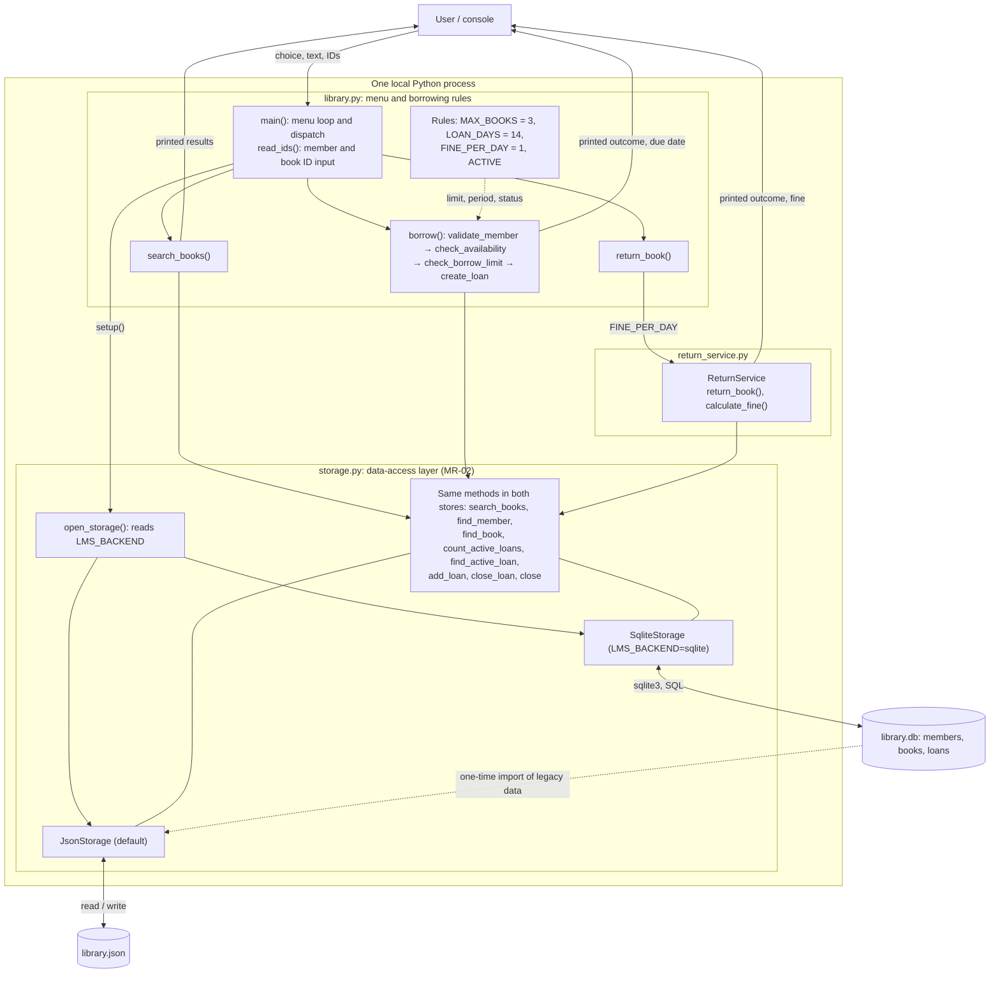
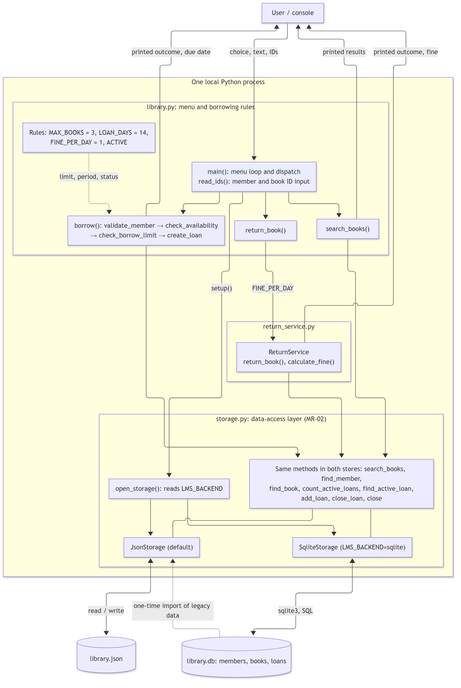

# Final Reengineered System and To-Be Architecture
Task: #32 | Owner: Muayyad Alnouman | Status: done | Date: 24/11

## Report summary

The final system keeps the six original requirements and the same console behavior, but its structure has changed from one procedural file into three modules with separate jobs. `library.py` holds the menu, the search and the borrow checks, with the library rules as named constants. `return_service.py` holds `ReturnService`, which runs a return and calculates the late fine. `storage.py` is the data-access layer from MR-02: the program never talks to a database directly, and the store is a JSON file by default or the legacy SQLite database when `LMS_BACKEND=sqlite`. Figure 6 shows this to-be structure, which can be compared with the as-is structure in Figure 3. In the course's terms, the project followed the general reengineering model: reverse engineering in Phase 1, alteration in Phases 2 and 3, and forward engineering back into Python (p.133). Most changes are recode (refactoring) and redesign (a new data-access layer and data model) (p.137); MR-01 also respecified requirement 3 (p.138). We used the rework strategy (p.140) and the incremental approach (p.144). The final clean-up for #32 added a module docstring, PEP 8 spacing and one Extract Method for the duplicated ID input. The 12 behavior tests still pass, and the menu output is unchanged.

## Details

### Final clean-up (#32)

The clean-up starts from Commit 05 (`8bd7ab7`). It only changes `library.py`. `storage.py` (MR-02), `return_service.py`, the tests and the tools already had a docstring at the top and did not change.

| Change | Smell (`docs/phase1/code-smells.md`) | What changed in `library.py` |
|---|---|---|
| Module docstring | CS8, no comments or documentation | A docstring at the top says what the module holds, where return/fine and data access are, and how to run it |
| PEP 8 blank lines | Readability | Two blank lines between top-level functions, one blank line between the standard-library and project imports |
| Extract Method `read_ids()` | CS4, duplicated code in `main()` | Borrow and Return used to read the member ID and book ID with the same two lines. Both now call `read_ids()`, so the input is written once |

The `read_ids()` refactoring follows the course refactoring activities (p.271): we identified the smell (CS4 from task #13), applied an Extract Method, and checked that the input/output behavior is the same (p.274).

Before (`main()`, Commit 05):

```python
        elif choice == "2":
            member = input("Member ID: ")
            book = int(input("Book ID: "))
            borrow(db, member, book)

        elif choice == "3":
            member = input("Member ID: ")
            book = int(input("Book ID: "))
            return_book(db, member, book)
```

After:

```python
def read_ids():
    """Ask for the member ID and the book ID (menu choices 2 and 3)."""
    member = input("Member ID: ")
    book = int(input("Book ID: "))
    return member, book
...
        elif choice == "2":
            member, book = read_ids()
            borrow(db, member, book)

        elif choice == "3":
            member, book = read_ids()
            return_book(db, member, book)
```

The prompts, their order and the `int()` conversion are the same, so the user sees the same thing.

Not changed on purpose: AP5, the crash when a book ID is not a number. Fixing it changes what the user sees (an error message instead of a stack trace), so it is a corrective change and not a refactoring. After `read_ids()`, a fix would only have to be made in one place.

The README now has "How to run" (including `LMS_BACKEND`) and "How to run the tests".

### Verification

| Check | Commit 05 (`8bd7ab7`), before | After the clean-up |
|---|---|---|
| Behavior tests, `python -m unittest discover -s tests -v` | 12 / 12 OK | 12 / 12 OK |
| Menu run, `tests/menu_session.txt`, `LMS_BACKEND=json`, empty folder | reference output (82 lines) | identical |
| Menu run, `tests/menu_session.txt`, `LMS_BACKEND=sqlite`, empty folder | reference output (82 lines), identical to JSON | identical |

The menu outputs were compared with `diff`, with the due date replaced by `<date>` because it depends on the day of the run.

### Figure 6: final (to-be) architecture



*Figure 6: Final (to-be) architecture. `library.py` and `return_service.py` call only the storage methods; all SQL is inside `SqliteStorage`.*

### Comparison with the as-is architecture (Figure 3)

Figure 3 (`docs/phase1/architecture.md`) shows the legacy system as one module, `library.py`, with five functions. Each function mixed the console output, the business rules and raw SQL against `library.db`.

| Aspect | As-is (Figure 3, Commit 01) | To-be (Figure 6, after #32) | Changed by |
|---|---|---|---|
| Modules | 1 (`library.py`) | 3: `library.py`, `return_service.py`, `storage.py` | MR-02, #25 |
| Functions / classes (`tools/metrics.py`) | 5 / 0 | 37 / 3 (`ReturnService`, `SqliteStorage`, `JsonStorage`) | MR-02, #24, #25, #32 |
| Where SQL is | 17 statements in 4 of the 5 functions | Only in `storage.py` (`SqliteStorage`); none in `library.py` or `return_service.py` | MR-02 |
| Database | SQLite file only, bound to `sqlite3` | JSON file by default, SQLite as a fallback, chosen by `LMS_BACKEND` | MR-02 |
| Copies of a book | One `available` flag per title | `available` counts copies on the shelf, plus `total_copies` | MR-01 |
| `borrow()` | One long function, five jobs | Calls four small checks in order | #24 |
| Return and fine | Inside `return_book()` with the SQL and the messages | `ReturnService`; the fine rule is one method with no database and no printing | #25 |
| Rule values | Literals 3, 14, `"ACTIVE"`, and an unwritten fine rate of 1 | Named constants at the top of `library.py` | #26 |
| Menu input | Same ID input code written twice | `read_ids()` | #32 |
| Documentation in the code | 0 comments, 0 docstrings | Docstring at the top of every file and on the extracted functions | #24–#26, #32 |
| Tests | none | 12 behavior tests | #23 |

The legacy numbers are from `docs/phase1/baseline-metrics.md` (#14). The to-be numbers are from `python tools/metrics.py library.py return_service.py storage.py` on this branch. The full before-and-after measurement is task #34.

What stays the same: it is still one local process with a console menu, the operations still print their own messages (needed to keep the output identical), and the requirements R1–R6 and the menu are unchanged.

### In the course's reengineering terms (ch.4)

- **Objectives (p.127).** We reengineered mainly to improve maintainability, to migrate to a new storage technology (MR-02), and to prepare for functional enhancement: the Phase 4 Equipment design reuses the same rules and storage layer.
- **General model (pp.133, 135).** Reengineering = reverse engineering + Δ (alteration) + forward engineering. Phase 1 was the reverse engineering: Figure 3, the business rules and the smells are a more abstract view of the code. Phases 2 and 3 were the alteration, and each change was coded back into Python (forward engineering). The two dimensions of alteration from p.135 both appear: a change in functionality (MR-01, more than one copy) and a change in implementation technique (MR-02 and the refactorings, which the user does not see).
- **Types of change (pp.137–138).**
  - *Recode, by rephrasing* (same language): the refactorings #24–#26 and the #32 clean-up. The course lists refactoring as a rephrasing scenario (p.137).
  - *Redesign*: restructuring the architecture (the data-access layer from MR-02 and the `ReturnService` class from #25) and modifying the data model (`total_copies` from MR-01) (p.137).
  - *Respecify*: MR-01 changed the scope of requirement 3, from one available flag to several copies (p.138).
  - *Rethink* was not done: the system still works in the library domain. The Equipment system (Phase 4) was handled as domain engineering for reuse, as a design only.
- **Strategy (pp.139–141).** This is the *rework* strategy, which applies all three principles (p.140): abstraction (Phase 1 models and smells), alteration (the redesign and refactorings), and refinement (back into Python). It is not *rewrite*, because we did not translate the program into another language at the same level (p.139). It is not *replace*, because we did not rebuild the system from a higher-level representation (p.141).
- **Approach (p.144).** We used the *incremental* approach: the system was changed one step at a time, and each milestone commit (03, 04, 06) is an interim version that passes the same 12 tests. The course gives two advantages, and both applied: errors are easy to locate, because each step changes little, and progress is easy to see in the Git history. It also gives one disadvantage that we see: the whole architecture cannot be changed in one step, so the system is still a single console program with printing inside the operations.

### Still open

These items are not solved by the final system. Task #34 measures them, and they are candidates for future maintenance:
- AP5: a non-numeric book ID still crashes the menu with a `ValueError` (a corrective change, see above).
- AP1 is only partly solved: the borrow checks and `ReturnService.return_book()` still print their messages, so the business logic cannot be reused without console output. The functions doing console I/O besides `main()` went from 6 after #26 to 7, because `read_ids()` contains the `input()` calls that were in `main()`.
- AP5 (second part): the store is closed only on menu choice 4, with no `try`/`finally`.
- The Phase 4 domain architecture (`BorrowingRules`, `LoanStore` and the others) is a design and is not implemented.

## Screenshots



*Figure 6: Final (to-be) architecture, rendered from the Mermaid diagram above with mermaid-cli 12.2.0 (`flowchart.wrappingWidth` 420, scale 2).*

## Sources

- Course PDF `docs/reference/maintenance-course.pdf` (Tripathy & Naik slides), ch.4 Reengineering: p.127 (definition and objectives), p.133 (general model: reverse engineering, re-design, forward engineering), p.135 (Reengineering = reverse engineering + Δ + forward engineering; the two dimensions of alteration), pp.137–138 (types of change: recode, redesign, respecify, rethink), pp.139–141 (rewrite, rework and replace strategies), p.144 (incremental approach). Ch.7 Refactoring: p.271 (refactoring activities), p.274 (behavior preservation).
- Project documents: `docs/phase1/architecture.md` (#10, Figure 3), `docs/phase1/code-smells.md` (#13, smell IDs), `docs/phase1/baseline-metrics.md` (#14), `docs/phase3/refactoring-log.md` (#24–#27).
- M. Fowler, *Refactoring: Improving the Design of Existing Code*, 2nd ed., Addison-Wesley, 2018: Extract Function (Extract Method).
- PEP 8, Style Guide for Python Code, https://peps.python.org/pep-0008/ (blank lines, imports).
- Mermaid and mermaid-cli (`@mermaid-js/mermaid-cli`), used to draw and export Figure 6.
- AI tool: Claude (Anthropic), used to help apply the clean-up, run the checks, draw the diagram and draft this document. Reviewed and edited by the author.
